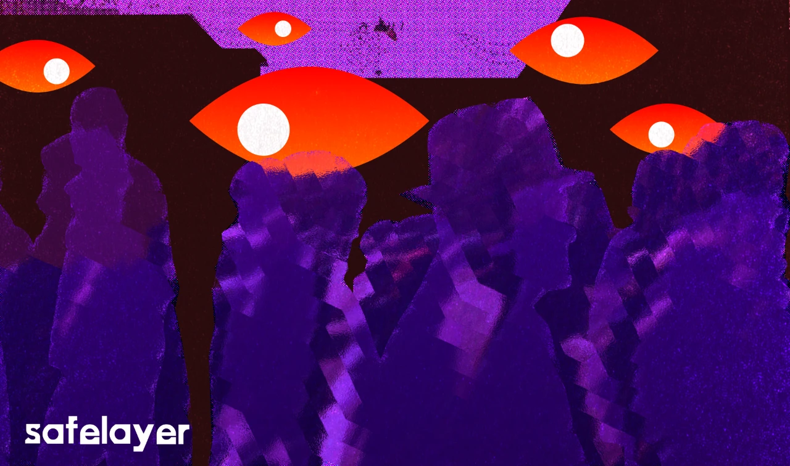

  

  
  
  
  

# Boas-vindas ao repositório do safelayer editor

<b>Índice</b>

- [O que tem aqui](#o-que-tem-aqui)
- [Instalar e rodar](#instalar-e-rodar)
  - [Instalador (recomendado)](#instalador-recomendado)
  - [Outros jeitos de instalar](#outros-jeitos-de-instalar)
  - [Distribuições](#distribuições)
- [Visão geral](#visão-geral)
- [Atualizações](#atualizações)
- [Perguntas frequentes](#perguntas-frequentes)
- [Recursos](#recursos)
- [Contribuir](#contribuir)
- [Falar com a equipe](#falar-com-a-equipe)
- [Segurança](#segurança)
- [Código de conduta](#código-de-conduta)
- [Licença](#licença)

## O que tem aqui

Este repositório guarda os **instaladores e as notas de versão** do safelayer editor, o editor de imagens, vídeos e motion feito de efeitos, com quatro softwares:

- **safelayer imagem:** retícula, threshold, bitmap, neon, glifos e mais; exporta PNG e SVG na medida certa para impressão.
- **safelayer vídeo:** linha do tempo de verdade, com efeitos, looks e transições em cada clipe, legenda automática, tradução e MP4 com som.
- **safelayer motion:** marque o início e o fim e o efeito anima sozinho; curvas e exportação em vídeo.
- **safelayer marca:** assets de marca, como o logo em 3D com chanfro, cromo, ouro e brilho, girando em laço; exporta PNG e vídeo.

O app instalado lê as versões publicadas aqui e se atualiza sozinho. O código-fonte não é aberto.

---

## Instalar e rodar

> [!NOTE]
> O safelayer editor precisa do Windows 10 ou 11, 64 bits.

### Instalador (recomendado)

Baixe o instalador e abra:

**[⬇ Baixar o safelayer editor para Windows](https://github.com/bingzhanstudios/effects-dae-atualizacoes/releases/latest/download/safelayer-editor-instalador.exe)**

Ele instala só para o seu usuário (não pede administrador), cria o atalho no menu Iniciar e **se atualiza sozinho** a cada versão nova. É o jeito que preferimos.

### Outros jeitos de instalar

#### Portátil

Para rodar sem instalar (pendrive, computador sem permissão para instalar), baixe o `safelayer-editor-<versão>-portatil.exe` na página da [versão mais nova](https://github.com/bingzhanstudios/effects-dae-atualizacoes/releases/latest), em **Assets**, e abra.

> [!IMPORTANT]
> O portátil **não se atualiza sozinho**: ele avisa quando sai uma versão nova e leva você à página de download.

#### Uma versão específica

Todas as versões ficam em [Releases](https://github.com/bingzhanstudios/effects-dae-atualizacoes/releases). Abra a versão e baixe em **Assets**.

### Distribuições

| Distribuição | Sistema | Se atualiza sozinho | Link |
|---|---|---|---|
| Instalador | Windows 10 e 11, x64 | Sim | [Baixar](https://github.com/bingzhanstudios/effects-dae-atualizacoes/releases/latest/download/safelayer-editor-instalador.exe) |
| Portátil | Windows 10 e 11, x64 | Não (só avisa) | [Página da versão](https://github.com/bingzhanstudios/effects-dae-atualizacoes/releases/latest) |

> [!TIP]
> O link do instalador acima nunca muda: ele sempre baixa a versão mais nova. Pode mandar para quem ainda não tem o app.

---

## Visão geral

Criamos o safelayer editor porque quem cria sozinho (posts, vídeos curtos, peças de marca) pula entre três ou quatro programas pesados para aplicar um efeito só. Aqui, cada efeito pega uma imagem, um vídeo ou um texto, oferece controles finos e exporta o resultado, com a prévia desenhada na placa de vídeo para a edição não pesar.

Tudo roda no seu computador. A legenda automática, a tradução e o Remover fundo usam IA **no próprio computador**: o pacote de IA é baixado só na primeira vez que alguém usa e cada arquivo é conferido antes de rodar.

Os seus trabalhos ficam em **Projetos**, em cada software, e se salvam sozinhos a cada mudança. Ao fechar, o app sempre pergunta antes.

O app está em português, inglês e espanhol.

---

## Atualizações

A versão instalada procura atualização **ao abrir e a cada 6 horas**, baixa em segundo plano e avisa quando está pronta. Dá para desligar em **Configurações → Atualizações → Procurar sozinho**. A busca fala só com o GitHub, por HTTPS, e não envia nada sobre você.

Cada versão traz as notas do que mudou, na página de [Releases](https://github.com/bingzhanstudios/effects-dae-atualizacoes/releases) e dentro do app.

---

## Perguntas frequentes

### O Windows mostrou "O Windows protegeu o computador" ao abrir o instalador

**Causa:** o instalador ainda não tem assinatura digital, e o SmartScreen avisa sobre todo programa novo sem assinatura.

**Solução:** clique em **Mais informações** → **Executar assim mesmo**. Baixe sempre por este repositório.

### A legenda automática (ou o Remover fundo) demorou na primeira vez

**Causa:** na primeira vez, o app baixa o pacote de IA (cerca de 27 MB) e confere cada arquivo.

**Solução:** espere terminar; das próximas vezes ele já está no computador e abre na hora.

### Usei o portátil e não recebi a versão nova

**Causa:** o portátil não se atualiza sozinho.

**Solução:** baixe a versão nova na página de [Releases](https://github.com/bingzhanstudios/effects-dae-atualizacoes/releases/latest) ou passe a usar o [instalador](#instalador-recomendado).

---

## Recursos

- [Notas de versão](https://github.com/bingzhanstudios/effects-dae-atualizacoes/releases): o que mudou em cada versão.
- [Abrir um relato de bug](https://github.com/bingzhanstudios/effects-dae-atualizacoes/issues/new/choose).

---

## Contribuir

Ficamos felizes com cada relato e sugestão: é deles que sai cada versão.

**ANTES de abrir uma issue**, leia o [guia de contribuição](CONTRIBUTING.md) para o seu relato chegar com tudo o que precisamos.

## Falar com a equipe

O jeito mais fácil de falar com a equipe é pelas [issues](https://github.com/bingzhanstudios/effects-dae-atualizacoes/issues).

Abra relatos de bug e sugestões por lá, mas **procure antes se já existe uma issue igual, aberta ou fechada**.

- Renato Sousa, dono do produto e design: [@myangdae](https://github.com/myangdae)

## Segurança

Não reporte falha de segurança em issue pública. Veja como reportar em [SECURITY.md](SECURITY.md).

---

## Código de conduta

Este projeto adota o [Código de conduta](CODE_OF_CONDUCT.md) baseado no Contributor Covenant.

## Licença

O safelayer editor é **gratuito**, mas **não é de código aberto**. Veja os termos de uso em [LICENSE](LICENSE).

safelayer editor é uma marca da SFL Creative, da Safelayer Inc. · software da Bingzhan Studios, feito pela equipe Aurea Sub Studio.
